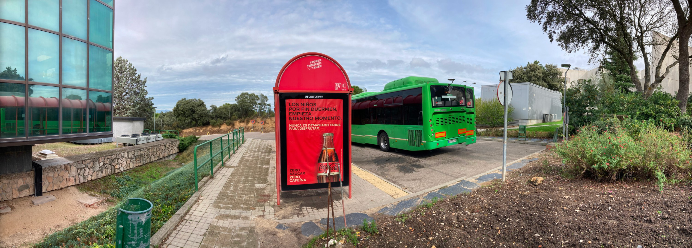
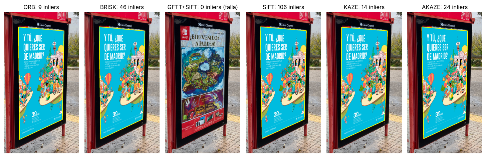
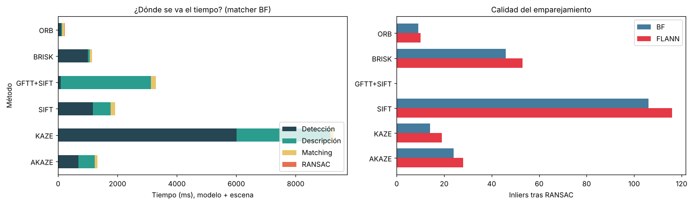
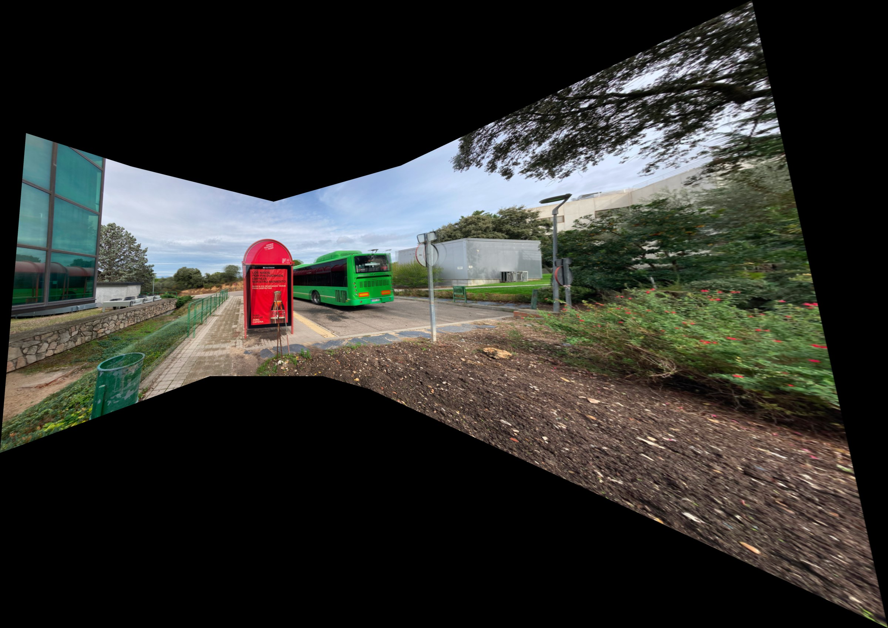
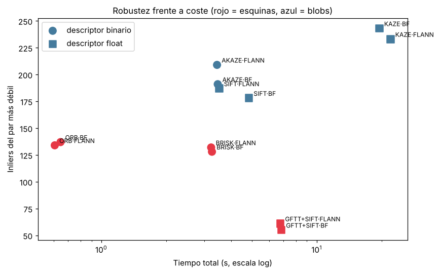
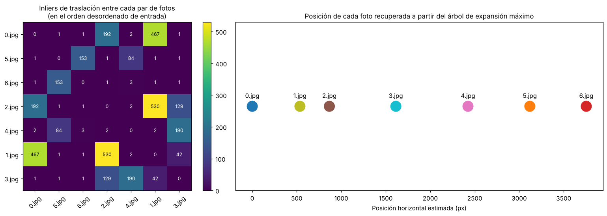
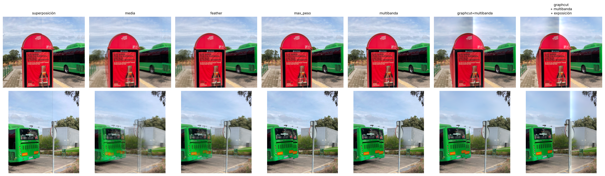

# 🌄 Panorama Image Stitching con OpenCV

Implementación desde cero, **sin `cv2.Stitcher`**, de todo el proceso para crear panorámicas: detección de características, emparejamiento robusto, homografías, proyección cilíndrica, **ordenación automática de fotos desordenadas** y comparación de **6 técnicas de blending**.


> Práctica de la asignatura **Fundamentos de Análisis de Imagen** (Grado en Ciencia de Datos e Inteligencia Artificial, UPM · curso 2025-26), realizada por **Antía Sande Fernández**, **Sergio Medina Hernández** y **Martín Hernández Castaño**.

**👉 [Notebook completo con resultados](notebooks/panorama_stitching.ipynb) · [Memoria (PDF)](docs/memoria.pdf) · [Código del pipeline](src/panorama.py)**


<sub>Panorámica *wide-view* de 7 fotos: AKAZE + FLANN, proyección cilíndrica con focal estimada y mezcla multibanda.</sub>

---

## Parte 1 · Detección de un plano e inserción con homografías

Se localiza un cartel en la foto de una marquesina y se sustituye por otro con la perspectiva correcta. Se comparan **6 combinaciones de detector y descriptor**, que cubren *esquinas / blobs* × *binario / float*, cada una con **fuerza bruta y FLANN** (12 experimentos), midiendo el tiempo de cada fase.



| | Descriptor binario | Descriptor float |
|---|---|---|
| **Esquinas** | ORB, BRISK | GFTT + SIFT |
| **Blobs** | AKAZE | SIFT, KAZE |



- **SIFT** obtiene el emparejamiento más sólido (≈110 inliers) y **AKAZE** es el mejor compromiso entre velocidad y precisión.
- **Las esquinas sin estimación de escala fallan:** GFTT + SIFT no encuentra el cartel aunque usa el mismo descriptor que SIFT. ORB y BRISK sí lo encuentran gracias a sus pirámides de escala.
- La **detección** domina el tiempo: KAZE tarda unos 9 s y ORB unos 0,15 s.

## Parte 2 · Panorámica planar de 5 imágenes

Homografías entre fotos consecutivas, encadenadas hacia la imagen central, y *feathering*.



El benchmark de las 12 combinaciones mide los inliers del par más débil (el eslabón que más limita la alineación), el error de reproyección y los tiempos. **AKAZE + FLANN** ofrece el mejor equilibrio: más de 200 inliers en el par más débil en unos 3 s. KAZE es algo más robusto, pero 5 veces más lento.



## Parte 3 · Panorámica *wide-view* de 7 imágenes

Con 7 fotos el campo de visión supera los 180° y la proyección planar diverge, con un lienzo de 15.000 × 12.000 px. La solución:

1. **Proyección cilíndrica**, en la que el movimiento entre fotos pasa a ser una **traslación**, estimada con RANSAC.
2. **Estimación de la distancia focal** por búsqueda en rejilla, maximizando los inliers (f ≈ 1.800 px frente a los 1.210 px de la heurística original).
3. **Corrección de la deriva vertical** con un ajuste lineal de la posición de las fotos.
4. **Fotos desordenadas:** se emparejan todos los pares, se construye un grafo de solapes y se calcula su **árbol de expansión máximo** (Kruskal). Las posiciones acumuladas dan el orden de izquierda a derecha.



### Comparación de blending



| Estrategia | Resultado |
|---|---|
| Superposición | Costuras rectas visibles |
| Media / Feathering | Fantasmas: el autobús y la señal salen duplicados |
| Máximo peso | Nítido, pero la costura corta el autobús, que se movió entre fotos |
| **Multibanda** ✅ | Costuras de brillo invisibles y sin fantasmas en las zonas estáticas |
| GraphCut + multibanda | La costura rodea el autobús, pero deja franjas de brillo en el cielo |

## Estructura del repositorio

```
├── src/
│   └── panorama.py              # Pipeline completo: features, matching, RANSAC, proyecciones, blending, ordenación
├── notebooks/
│   └── panorama_stitching.ipynb # Experimentos de las 3 partes, con todas las salidas
├── images/                      # Imágenes de entrada (modelo, escena, cartel y fotos 0–6)
├── docs/
│   ├── memoria.pdf              # Memoria entregada
│   └── img/                     # Figuras del README
└── requirements.txt
```

## Cómo ejecutarlo

```bash
git clone https://github.com/antiasande/panorama-stitching.git
cd panorama-stitching
pip install -r requirements.txt
jupyter notebook notebooks/panorama_stitching.ipynb
```

El módulo también se puede usar directamente:

```python
import sys; sys.path.insert(0, "src")
import cv2, panorama as P

fotos = [cv2.cvtColor(cv2.imread(f"images/{i}.jpg"), cv2.COLOR_BGR2RGB) for i in range(7)]
f, _ = P.estimar_focal(fotos, "akaze", "flann")
pano, info = P.stitching_wideview(fotos, "akaze", "flann", f=f, ordenadas=False, blending="multibanda")
```

Funciona con OpenCV 4.x y 5.x: en la versión 5, BRISK, AKAZE y KAZE se cargan desde `xfeatures2d`. La ejecución completa del notebook tarda unos 5 minutos.

## Cambios respecto a la entrega original

Al preparar el repositorio, revisé el código, que estaba repartido en varios notebooks, y lo unifiqué en un módulo y un notebook. Los cambios más importantes:

- **Corrección del encadenado de homografías.** En la Parte 2 se multiplicaban en orden invertido (`H[i] @ T[i+1]` en lugar de `T[i+1] @ H[i]`). Las fotos contiguas a la de referencia no se veían afectadas, pero las de los extremos se desplazaban entre 20 y 33 px y aparecían fantasmas. El notebook lo mide y lo compara.
- **Comparativa completa de la Parte 1:** se ha pasado de 2 a 6 combinaciones (esquinas / blobs × binario / float), cada una con BF y FLANN, con tiempos por fase normalizados por número de puntos y una medida de precisión respecto al consenso.
- **Se ha añadido la ordenación automática** de fotos desordenadas (árbol de expansión máximo), que pedía el enunciado y no estaba en la versión final.
- **Estimación de la focal** en lugar de una heurística fija. Así aumentan los inliers de los pares más difíciles.
- **Mejor combinación según el benchmark:** AKAZE + FLANN, en lugar de SIFT + FLANN, que no se había comparado con AKAZE.
- **Reproducibilidad y memoria:** semillas fijas para RANSAC y FLANN, panorámica planar compuesta a resolución reducida, y GraphCut calculado a escala reducida (antes intentaba reservar 22 GB).

## Autores

- **Antía Sande Fernández** · [GitHub](https://github.com/antiasande)
- **Sergio Medina Hernández**
- **Martín Hernández Castaño**

Las fotografías fueron tomadas por el grupo. Los carteles de la Parte 1 se usan únicamente con fines académicos.

## Tecnologías

Python · OpenCV · NumPy · pandas · Matplotlib · Jupyter
